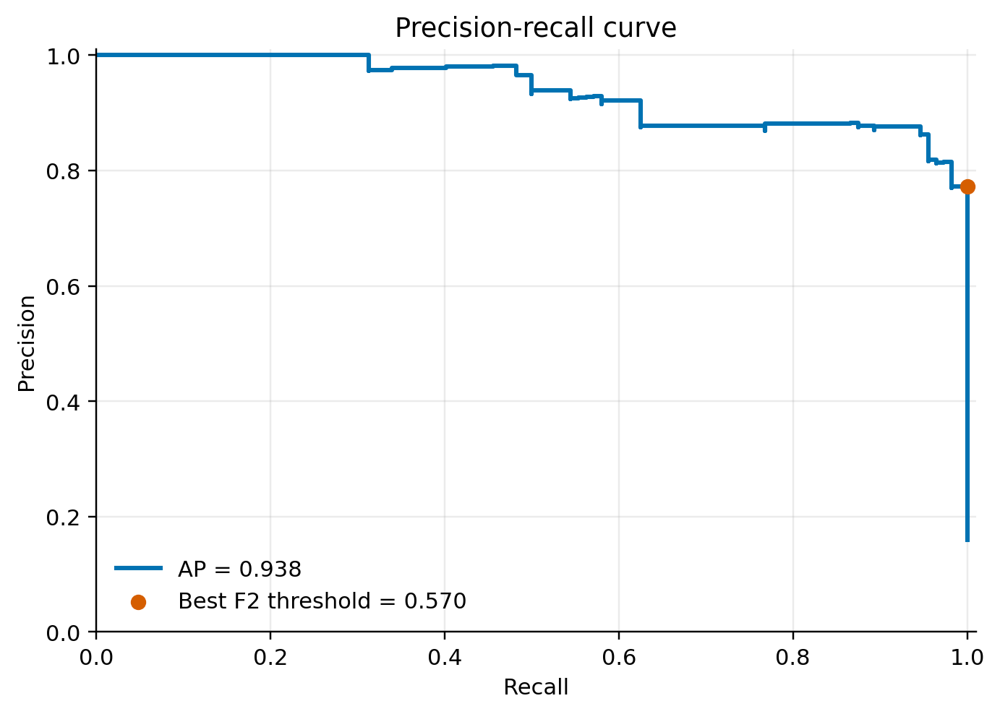
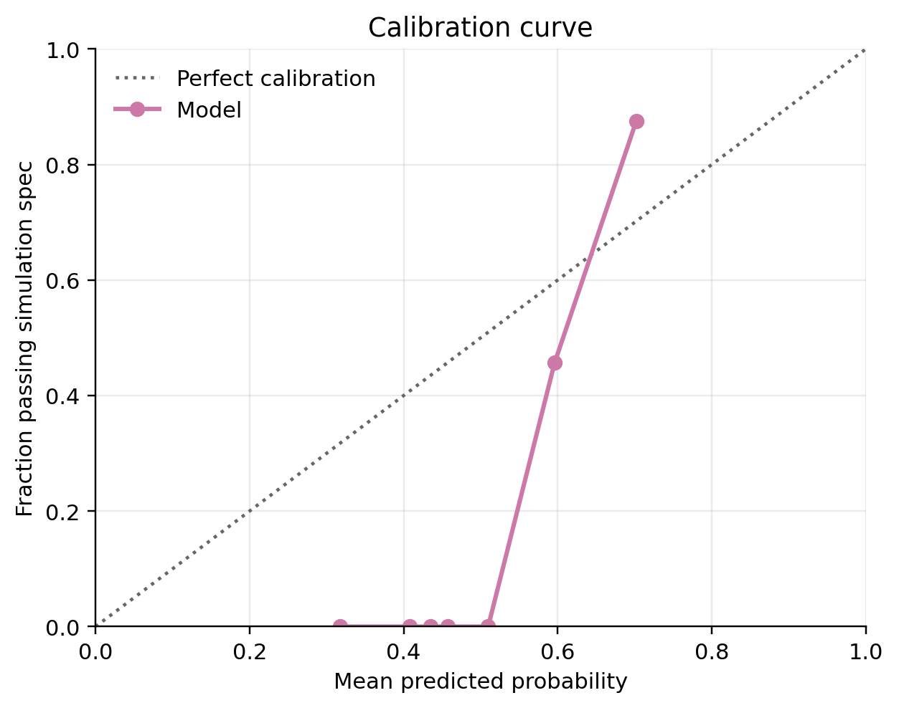
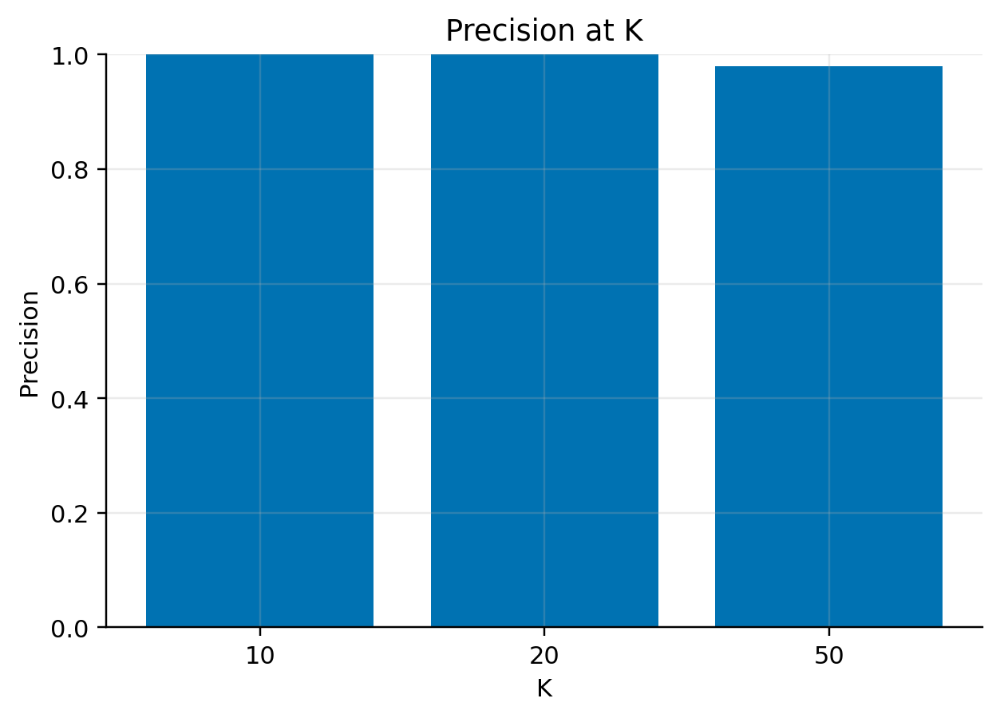
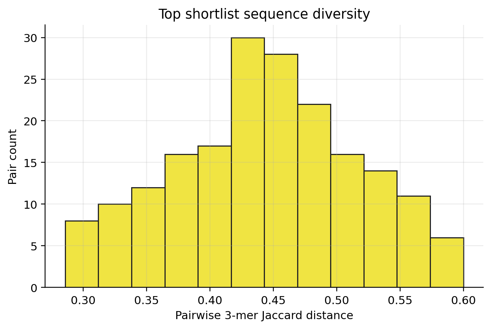

# RNA Thermoswitch ML Screening

Physics-guided ML pipeline for ranking simulated RNA thermoswitch candidates from thermodynamic features.

## Important Disclaimer

This project uses thermodynamic simulation-derived targets. It is a candidate-prioritisation workflow, not a wet-lab validated biotechnology product. Outputs should be interpreted as simulation-guided ranking under thermodynamic model assumptions, and the generated shortlist is intended for future experimental validation.

No candidate in this repository should be described as experimentally proven, biologically confirmed, production-ready, or wet-lab validated.

## Problem Statement

RNA thermoswitches are RNA sequences that can change structure or accessibility with temperature, potentially regulating gene expression in a temperature-dependent way. In practice, the candidate design space can be large, and experimentally testing every sequence can be expensive.

This project treats thermoswitch screening as a scientific machine learning problem: use thermodynamic simulation outputs to train models that prioritise promising simulated candidates before any experimental validation step.

## What This Project Demonstrates

- Scientific feature engineering from RNA sequence and design metadata
- Thermodynamic simulation-derived label creation
- Calibrated classification for pass-probability ranking
- Regression for predicted T50 and slope at 70 C
- Imbalanced classification evaluation with PR-AUC as the lead metric
- Ranking metrics and Top-K candidate selection
- Diversity filtering and lightweight sequence QC
- Reproducible command-line scripts
- Model evaluation, data dictionary, limitations, and model-card documentation
- Pytest coverage for feature, label, model, evaluation, plotting, and shortlist logic

## Dataset Overview

The canonical public modelling dataset is:

```text
data/processed/library_combined.csv
```

It contains 700 processed candidate rows. The public repository workflow uses this lightweight processed dataset rather than large raw simulation sweeps.

Important data notes:

- Labels and regression targets are thermodynamic simulation-derived.
- Raw sweeps are excluded from normal GitHub to keep the repo lightweight.
- Observed target columns are not used as inference features.
- `reports/results/ml_predictions.csv` is an output artefact and must not be used as training input.

See [data/README.md](data/README.md) and [docs/data_dictionary.md](docs/data_dictionary.md) for details.

## Methodology Overview

The canonical workflow:

1. Load `data/processed/library_combined.csv`.
2. Build sequence and design features from inference-available fields.
3. Create a simulation-derived pass/fail label from thermodynamic target columns.
4. Train a calibrated classifier for `p_pass`.
5. Train regressors for `T50` and `slope70`.
6. Evaluate classification, ranking, calibration, and regression performance.
7. Export candidate predictions.
8. Rank Top-K candidates by pass probability, predicted T50 closeness to 70 C, and predicted slope.
9. Apply diversity filtering and QC filters.
10. Export a clean shortlist and order sheet.
11. Generate report figures.

More detail: [docs/methodology.md](docs/methodology.md).

## Results

The table below uses values from the canonical evaluation report:

```text
reports/model_evaluation.md
```

These are metrics against thermodynamic simulation-derived labels, not experimental outcomes.

| Item | Value |
|---|---:|
| Dataset rows | 700 |
| Simulation-derived positives | 112 |
| Positive rate | 0.160 |
| Feature count | 229 |
| Train/test Average Precision / PR-AUC | 0.385 |
| Train/test ROC-AUC | 0.736 |
| Train/test Brier score | 0.212 |
| Clean shortlist size | 20 |
| Order-sheet GC range | 0.26-0.33 |
| Order-sheet length range | 46-50 nt |
| Homopolymer warning count at n>=7 | 0 |

The evaluation report also includes expected random-ranking baseline values for Top-K context. Full-library prediction outputs are in-sample scoring artefacts, so they should not be presented as held-out deployment performance.

Read the full report: [reports/model_evaluation.md](reports/model_evaluation.md).

## Key Figures

Precision-recall curve from simulation-derived labels:



Calibration summary:



Top-K precision:



Top shortlist diversity:



Additional generated figures are available in [reports/figures/](reports/figures/), including Recall@K, predicted T50/slope distributions, and library GC/length distributions.

## How To Run

Windows PowerShell:

```powershell
python -m venv .venv
.\.venv\Scripts\activate
pip install -r requirements.txt

python -m pytest tests
python scripts/evaluate_model.py
python scripts/predict_candidates.py
python scripts/make_shortlist.py
python scripts/make_figures.py
```

macOS/Linux:

```bash
python -m venv .venv
source .venv/bin/activate
pip install -r requirements.txt

python -m pytest tests
python scripts/evaluate_model.py
python scripts/predict_candidates.py
python scripts/make_shortlist.py
python scripts/make_figures.py
```

## Project Structure

```text
.
|-- data/
|   |-- README.md
|   `-- processed/
|       `-- library_combined.csv
|-- docs/
|   |-- data_dictionary.md
|   |-- limitations.md
|   |-- methodology.md
|   `-- model_card.md
|-- notebooks/
|   `-- 01_thermoswitch_pipeline_exploration.ipynb
|-- reports/
|   |-- model_evaluation.md
|   |-- figures/
|   `-- results/
|-- scripts/
|   |-- evaluate_model.py
|   |-- make_figures.py
|   |-- make_shortlist.py
|   |-- predict_candidates.py
|   `-- train_model.py
|-- src/
|   `-- thermoswitch/
`-- tests/
```

## Outputs

Key generated outputs:

- [reports/model_evaluation.md](reports/model_evaluation.md): canonical evaluation report
- [reports/results/ml_predictions.csv](reports/results/ml_predictions.csv): generated prediction artefact
- [reports/results/ml_topk_diverse_clean.csv](reports/results/ml_topk_diverse_clean.csv): clean diversified shortlist
- [reports/results/ml_order_sheet.csv](reports/results/ml_order_sheet.csv): practical order-sheet export
- [reports/figures/](reports/figures/): generated report figures

## Documentation

- [Methodology](docs/methodology.md)
- [Limitations](docs/limitations.md)
- [Data dictionary](docs/data_dictionary.md)
- [Model card](docs/model_card.md)
- [Data README](data/README.md)

## Limitations

- Labels and targets are thermodynamic simulation-derived.
- No wet-lab validation has been performed.
- The canonical processed dataset is small for biological sequence modelling.
- Current validation does not use a sequence-similarity-aware split.
- Full-library scoring artefacts are in-sample outputs.
- Baselines are currently limited to expected random-ranking context.
- Saved production-style model artefacts are not published yet.
- The lightweight F1 openness figure uses stored simulation curve values rather than fresh NUPACK recomputation.

See [docs/limitations.md](docs/limitations.md) for the full limitations note.

## Future Work

- Add stronger baselines such as rule-based ranking, logistic regression, and GC/length-only models.
- Add sequence-similarity-aware splitting and near-duplicate audits.
- Save model artefacts, feature schema, and model metadata.
- Add a Streamlit or FastAPI demo for interactive candidate scoring.
- Add GitHub Actions for automated tests.
- Prepare candidates for future experimental validation in a real assay context.

## Skills Demonstrated

- Python
- pandas and NumPy
- scikit-learn
- Model calibration
- Regression
- Ranking metrics
- Scientific machine learning
- Reproducible ML pipelines
- Testing with pytest
- Technical documentation

## Suggested Repository Metadata

Recommended GitHub description:

```text
Physics-guided ML pipeline for ranking RNA thermoswitch candidates from thermodynamic simulation features.
```

Recommended topics:

```text
machine-learning
data-science
bioinformatics
synthetic-biology
rna
scientific-computing
scikit-learn
model-calibration
ranking
candidate-screening
portfolio-project
```
